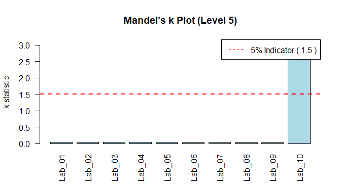

# Vignette Title


## Introduction

The `ringtest` package implements the statistical workflow outlined in
**ISO 5725-2:2025** (*Accuracy (trueness and precision) of measurement
methods and results — Part 2: Basic method for the determination of
repeatability and reproducibility of a standard measurement method*).

This vignette demonstrates how to: 1. Load interlaboratory (ring test)
data. 2. Compute basic cell statistics (means, standard deviations) and
Mandel’s consistency statistics (*h* and *k*). 3. Perform numerical
outlier detection using Cochran’s and Grubbs’ tests. 4. Estimate
level-specific repeatability (*s*<sub>*r*</sub>) and reproducibility
(*s*<sub>*R*</sub>) standard deviations. 5. Fit functional relationships
between precision components and mean level (*m*).

------------------------------------------------------------------------

## 1. Loading Sample Ring Test Data

We load a dataset consisting of *p* = 10 laboratories measuring *q* = 5
items/levels with *n* = 5 replicates per laboratory-level cell.

``` r
library(ringtest)

# Read sample CSV data
ringtest <- read.csv(
  here::here("inst/extdata/ringtest_data.csv"), stringsAsFactors = FALSE)
head(ringtest)
```

         lab   level replicate value
    1 Lab_01 Level_1         1 10.12
    2 Lab_01 Level_1         2 10.08
    3 Lab_01 Level_1         3 10.15
    4 Lab_01 Level_1         4 10.11
    5 Lab_01 Level_1         5 10.14
    6 Lab_01 Level_2         1 20.25

------------------------------------------------------------------------

## 2. Calculating Cell Statistics and Mandel’s *h* & *k*

Next, we calculate cell means (*ȳ*<sub>*i**j*</sub>), within-cell
standard deviations (*s*<sub>*i**j*</sub>), and Mandel’s consistency
statistics (*h* and *k*).

``` r
cell_stats <- calc_cell_stats(ringtest)
cell_stats <- calc_mandel_hk(cell_stats)

head(cell_stats)
```

         lab   level n   mean         sd           h         k
    1 Lab_01 Level_1 5 10.120 0.02738613  0.28434398 1.2500000
    2 Lab_02 Level_1 5 10.050 0.02236068 -1.29534478 1.0206207
    3 Lab_03 Level_1 5 10.190 0.02236068  1.86403274 1.0206207
    4 Lab_04 Level_1 5 10.090 0.01581139 -0.39266549 0.7216878
    5 Lab_05 Level_1 5 10.128 0.01923538  0.46487984 0.8779711
    6 Lab_06 Level_1 5 10.106 0.02073644 -0.03159378 0.9464847

### Visualizing Mandel’s *h* and *k* Indicators

Mandel’s *h* statistic highlights between-laboratory consistency, while
Mandel’s *k* statistic highlights within-laboratory variability.

``` r
# Critical indicator lines for p=10, n=5 at alpha=0.05
h_ind <- mandel_h_indicator(p = 10, alpha = 0.05)
k_ind <- mandel_k_indicator(p = 10, n = 5, alpha = 0.05)

# Plot Mandel's k for Level 5
lvl5_k <- cell_stats[cell_stats$level == "Level_5", ]
barplot(lvl5_k$k, names.arg = lvl5_k$lab, main = "Mandel's k Plot (Level 5)",
        ylab = "k statistic", col = "lightblue", las = 2)
abline(h = k_ind, col = "red", lty = 2, lwd = 2)
legend("topright", legend = paste("5% Indicator (", round(k_ind, 2), ")"), col = "red", lty = 2)
```



Notice that **Lab_10** exhibits a strong spike in *k* at Level 5.

------------------------------------------------------------------------

## 3. Screening Outliers Level-by-Level

ISO 5725-2 specifies Cochran’s test for variance heterogeneity and
Grubbs’ tests (single and double) for outlying means.

``` r
# Screening Level_2 (contains high mean outlier at Lab_08)
lvl2_stats <- cell_stats[cell_stats$level == "Level_2", ]
grubbs_lvl2 <- test_grubbs_single(lvl2_stats)

cat("Grubbs Test (Level 2):\n")
```

    Grubbs Test (Level 2):

``` r
cat("Suspect Lab :", grubbs_lvl2$suspect_lab, "\n")
```

    Suspect Lab : Lab_08 

``` r
cat("Statistic   :", round(grubbs_lvl2$statistic, 4), "\n")
```

    Statistic   : 2.6898 

``` r
cat("1% Critical :", round(grubbs_lvl2$crit_1, 4), "\n")
```

    1% Critical : 2.4821 

``` r
cat("Status      :", grubbs_lvl2$status, "\n\n")
```

    Status      : Outlier (**) 

``` r
# Screening Level_5 (contains high variance outlier at Lab_10)
lvl5_stats <- cell_stats[cell_stats$level == "Level_5", ]
cochran_lvl5 <- test_cochran(lvl5_stats)

cat("Cochran Test (Level 5):\n")
```

    Cochran Test (Level 5):

``` r
cat("Suspect Lab :", cochran_lvl5$suspect_lab, "\n")
```

    Suspect Lab : Lab_10 

``` r
cat("Statistic   :", round(cochran_lvl5$statistic, 4), "\n")
```

    Statistic   : 0.999 

``` r
cat("1% Critical :", round(cochran_lvl5$crit_1, 4), "\n")
```

    1% Critical : 0.0025 

``` r
cat("Status      :", cochran_lvl5$status, "\n")
```

    Status      : Outlier (**) 

------------------------------------------------------------------------

## 4. Estimating Precision Parameters (*s*<sub>*r*</sub> and *s*<sub>*R*</sub>)

After eliminating confirmed statistical outliers (\*\*), we compute the
general mean (*m̂*<sub>*j*</sub>), repeatability standard deviation
(*s*<sub>*r**j*</sub>), between-laboratory standard deviation
(*s*<sub>*L**j*</sub>), and reproducibility standard deviation
(*s*<sub>*R**j*</sub>).

``` r
# Clean outliers
clean_stats <- cell_stats
clean_stats$mean[clean_stats$level == "Level_2" & clean_stats$lab == "Lab_08"] <- NA
clean_stats$sd[clean_stats$level == "Level_2" & clean_stats$lab == "Lab_08"] <- NA

clean_stats$sd[clean_stats$level == "Level_5" & clean_stats$lab == "Lab_10"] <- NA

# Calculate precision metrics per level
levels <- unique(clean_stats$level)
precision_results <- do.call(rbind, lapply(levels, function(lvl) {
  sub <- clean_stats[clean_stats$level == lvl, ]
  res <- calc_iso_variances(sub)
  res$level <- lvl
  res
}))

print(precision_results[, c("level", "p", "m_hat", "s_r", "s_L", "s_R")])
```

        level  p    m_hat        s_r        s_L        s_R
    1 Level_1 10 10.10740 0.02190890 0.04321574 0.04845204
    2 Level_2  9 20.22844 0.02507766 0.06980688 0.07417472
    3 Level_3 10 30.38040 0.02722132 0.12336783 0.12633536
    4 Level_4 10 40.50000 0.02807134 0.15250413 0.15506615
    5 Level_5 10 50.63540 0.02725803 0.20361374 0.20543017

------------------------------------------------------------------------

## 5. Fitting Functional Relationships *s* = *f*(*m*)

When precision parameters depend on the mean level *m*, ISO 5725-2
recommends fitting functional relationships (Relationships I, II, III,
or IV).

``` r
# Fit Relationship I: s_r = b * m
model_sr <- fit_precision_relationship(precision_results$m_hat, precision_results$s_r, rel = "I")

# Fit Relationship II: s_R = a + b * m
model_sR <- fit_precision_relationship(precision_results$m_hat, precision_results$s_R, rel = "II")

cat("Repeatability Model    :", model_sr$formula, "\n")
```

    Repeatability Model    : s = b * m 

``` r
cat("Slope (b)              :", round(model_sr$params["b"], 5), "\n\n")
```

    Slope (b)              : 0.00111 

``` r
cat("Reproducibility Model  :", model_sR$formula, "\n")
```

    Reproducibility Model  : s = a + b * m 

``` r
cat("Intercept (a)          :", round(model_sR$params["a"], 5), "\n")
```

    Intercept (a)          : 0.00939 

``` r
cat("Slope (b)              :", round(model_sR$params["b"], 5), "\n")
```

    Slope (b)              : 0.00368 

------------------------------------------------------------------------

## 6. Full Automated ISO Workflow

All steps above can be executed in a single automated pipeline using
`run_iso5725_analysis()`:

full_analysis \<- run_iso5725_analysis(ringtest)

# Summary table of level precision

full_analysis$level_precision
